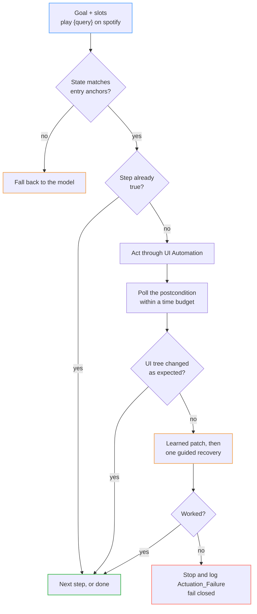

Most agents that act on software do it through connectors: one integration per app, and each one can only do what that app's API allows. I started Kore in November 2025 because I wanted to find out whether an AI could sit at a PC and use it the way a person does, in any app.

The first version worked well enough to show me the real problems. Computer-use agents are slow and expensive, and they aren't repeatable, because every click is a fresh guess from a screenshot. They grab your mouse and focus while they work. And they'll often tell you a task is done when nothing happened. That last one bothered me most. You can't leave an agent like that running on a real desktop.

I planned to apply to YC with Kore, but the timing didn't work out, so I kept building. For the next several months the question was how to make it faster, cheaper, more accurate and safer. Safety got most of my attention, because anyone who lets an agent drive their computer is mostly worried about what it will do wrong.

## Table of contents

## Demos

These are unedited screen recordings. Kore's step log is the panel on the right.

### A cold run, then a learned one

<video controls preload="metadata" poster="/videos/kore-spotify.jpg" width="100%"><source src="/videos/kore-spotify.mp4" type="video/mp4"></video>

Two tasks back to back. The first, "play je te laisserai des mots on spotify", is a cold run: open Spotify, type the query, click the result. Kore's first play click gets a ✗ in the log, so it retries, and only then reports "Task complete".

The second, "play the night we met on spotify", starts with steps tagged PROCEDURE: _Focused app for procedure_, _Focused app_, _Entered query_. That's the procedure Kore learned from the first task, replayed with a new query. Choosing which result to play isn't tagged as part of the procedure, so that last step is still decided live.

### A different app

<video controls preload="metadata" poster="/videos/kore-flights.jpg" width="100%"><source src="/videos/kore-flights.mp4" type="video/mp4"></video>

"Show me the cheapest flights from ATL to BLR on August 8." Kore opens Chrome, searches Google, clicks the Flights tab and then the Cheapest tab, and ends up on a $904 round trip (Aug 8 to Aug 12, the dates Google Flights defaulted to). The page's "Travel restricted" banner is still on screen at the end.

### Background mode

<video controls preload="metadata" poster="/videos/kore-background.jpg" width="100%"><source src="/videos/kore-background.mp4" type="video/mp4"></video>

The same Spotify task with _Bound automation_ turned on in settings. Kore drives the target app through native UI Automation and only acts on that one window. It launches Spotify, clicks Search, types the query and clicks play while the OBS window I'm recording with stays in front.

## What I tried

**Speed and cost**

- Learn a task once as a procedure and replay it without asking the model what to click.
- Skip steps whose result is already true, so a replay can start partway through.
- Pull out the variable parts, like a search query or a contact name, so one procedure handles many inputs.
- Use plain rules to judge whether a step worked, and call a small LLM only when the rules can't tell.
- Track how reliable each procedure has been, and fall back to the model when one stops working.

**Accuracy**

- Read the Windows UI Automation tree (the one screen readers use) instead of guessing from pixels. Screenshots stay as a backup.
- Find things by label. If a label matches several things, return all of them instead of picking one.
- Target by control type and position in the UI, with no per-app special cases.
- After each step, wait for the result you expect and check it, with a time limit for each kind of action.

**Safety**

- Compare the UI tree before and after every action. If nothing changed, the action failed, whatever the model says.
- Work in the background without stealing focus, and put the user's window back if focus drifts.
- Limit recovery to one learned fix and one guided retry, then stop. End the run if the same action repeats with no change.
- Refuse clicks on title bars and window chrome, keep a kill switch (Ctrl+Shift+X), and keep everything on 127.0.0.1.
- Save what the model saw and did at every step, so any run can be replayed.

## Learned procedures

A task is a path from one desktop state to a goal state, and Kore keeps the path that worked. A procedure has entry points, then steps. Each step has an action template, ranked ways to find its target, the state expected afterward, and any fixes learned from past failures.

Replay walks that graph instead of running a script. It checks the starting state, skips steps that are already done, and waits for each step's expected state before moving on. In my tests, replaying a learned procedure was about 8x cheaper and 3x faster than planning from scratch, and it does the same thing every time.

## Failing closed

The check I trust most is the simplest one. The Rust UIA server fingerprints the UI tree before and after each action. Typing only counts if the text shows up in the window's tree. If nothing changed, Kore logs an `Actuation_Failure` instead of "done".

On top of that sits a judgment layer that asks whether a click hit the right thing and whether the goal is really met. Plain rules answer first, a small LLM only breaks ties, and the verdicts are cached. The LLM helps decide, but it isn't the authority.

## Background mode

Background control on Windows was the hardest part. The branch drives one bound window with posted Windows messages and UIA patterns and never calls `SetForegroundWindow`. It also does per-window `PrintWindow` capture, talks to Chromium over CDP, and restores the user's window if focus drifts. The input planner is a pure function covered by Hypothesis property tests. The goal is several agents working in several windows while you keep using your computer.

Kore is about 29k lines of Python, 6.7k of Rust and 2.7k of TypeScript, with 977 tests, ruff, mypy, clippy and a coverage gate. I wrote specs before code for the harder parts, and background mode has a full requirements and design doc.

## Talking to people who build this

Just before my Amazon internship I wrote to a number of people working on computer use. One of them, Ari Weinstein, replied. He's the CEO and co-founder of Software Applications Inc., the company behind Sky, which OpenAI acquired in October 2025, and he works on computer use there. We set up a call, I showed him Kore, and we kept talking about what it takes to do computer use well.

At one point he asked whether I knew how to do real background control on Windows. I didn't yet. I went away, learned how it works, implemented it in Kore, and it worked. That's where the background mode above comes from. I also spoke with his co-founder, Conrad Kramer, and a lot of that conversation was about the safety implications of letting an agent act on a machine.

It didn't turn into a role, but I learned a lot from those conversations, and they sharpened how I think about the safety side.

## What's next

I want to merge background mode into `main`, share learned procedures between users with a trust score, and turn the judgment layer into a policy gate for destructive actions like delete, send and pay.

Kore also made me look at the opposite end of the problem. App-specific connectors are fast and reliable, but someone has to write one for every app. What if they could be learned instead? That became [TAPI](/posts/tapi-learning-web-apis-without-leaking-credentials/).
