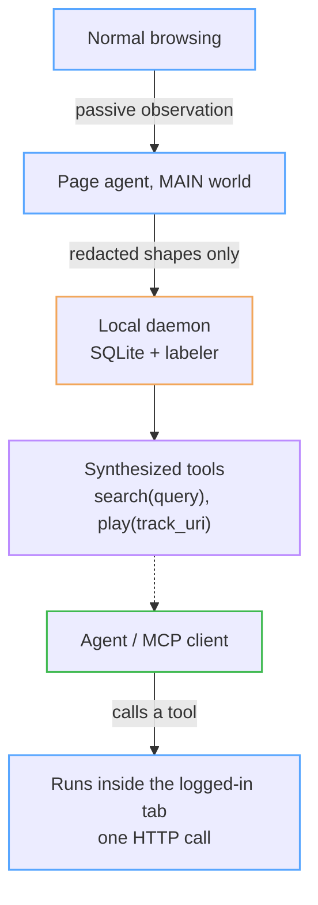
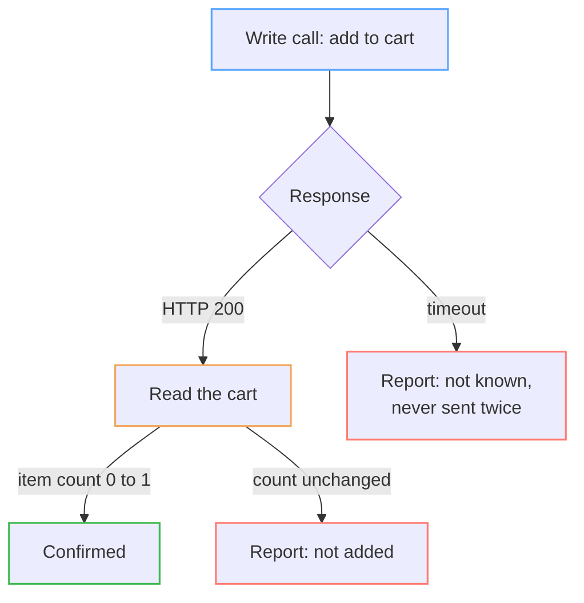

After [Kore](/posts/kore-computer-use-agent-that-fails-closed/) I kept coming back to connectors. They're fast and reliable because they call an app's own API instead of working through its screen, but someone has to write one for every app and keep it working. So I asked: what if connectors could write themselves, from what a real user does and the network traffic that results?

That's TAPI. It runs inside your own logged-in browser session. As you browse normally, it watches the requests your apps make. From a single sighting of an action, it builds a typed tool, like `search(query)` or `play(track_uri)`. Later, when an agent needs to do that thing, TAPI sends the app's own request from inside the tab. There are no screenshots, no clicking, and no credentials handed to anyone.

The first thing I designed around was credentials. A system that watches authenticated traffic and then acts inside your accounts has to treat tokens, cookies and sign-in flows as the main risk. Most of this post is about that.

I showed an early version to Brad Flora, a YC Group Partner. His advice was practical: find a co-founder, and work out who the end user is and who would actually pay. That's what I'm doing now.

## Table of contents

## Demos

These are unedited screen recordings. The Tapi side panel is on the right, and its Debug tab shows every call.

### One sentence, two calls

<video controls preload="metadata" poster="/videos/tapi-spotify.jpg" width="100%"><source src="/videos/tapi-spotify.mp4" type="video/mp4"></video>

From a blank new tab I type "play mystery lady on spotify". Tapi finds the Spotify tools it has learned and makes two calls. `search_top_results` takes 2.5 s (including opening the app) and returns 50 results. `play_context` takes 628 ms with the chosen track URI and comes back marked _confirmed_. The whole turn is 6.2 s, 2 actions and 0.06¢, with no screenshots and no clicks.

### Two sites in one conversation

<video controls preload="metadata" poster="/videos/tapi-openai-typesafe.jpg" width="100%"><source src="/videos/tapi-openai-typesafe.mp4" type="video/mp4"></video>

The clip opens on the OpenAI dashboard with Chrome DevTools on the Network tab, so the page's own API traffic is visible (`credit_grants`, `costs`, `limits`, `monthly_billing_alert`). That's the kind of traffic Tapi observes. The dashboard's Credit balance card reads $6.00.

At about 0:50 I ask "what's my OpenAI API balance?". Tapi searches its catalog (6 of 6 matching tools), calls `credit_grants`, and answers about $6.00 available and $4.00 used of $10.00 in credits. That takes 1.7 s and 0.07¢, and it matches the dashboard.

Then I ask "what about Typesafe, also what's the token usage in Typesafe?", which is a different site. Tapi reads the billing page, calls `list_api_usage`, and adds up the token counts in the returned records: about 29.16M input and 3.21M output tokens. It also points out that the dashboard's usage card shows 24M and says its stats may be delayed, so it reports the discrepancy instead of quietly picking one number.

In the Debug view, identifiers in the results show up as placeholders like `{{secret:apiKeyId}}`. That's the redaction described below, visible in a live response.

## How it works

One sighting is enough. There's no recording mode and there are no hand-written scraping rules. A deterministic classifier decides what role each parameter plays, a language model only supplies names, and the request itself is built by code, so no model ever writes an HTTP body.

Real apps guard their writes, so values have to be filled in at call time. Amazon's add-to-cart needs the right anti-forgery token out of six on the page, the right field order, and the right content type. TAPI fills each one from the live page or recent traffic when the call happens, using generic rules, with nothing written per site. Tool specs are versioned, a failing endpoint falls back to replaying the UI or relearning, and the whole catalog is exposed over MCP (`find_tools`, `call_tool`, `read_results`).

The catalog currently has 1,298 tools across 115 sites, learned from 5,998 endpoints with no per-app code. Spotify search-and-play takes about 5 s end to end (4.8 s in the benchmark run, 6.2 s in the demo above). An Amazon add-to-cart from a chat request takes 8.2 s with one API call, confirmed by the cart. An Instagram DM takes 0.31 s. A chat turn costs about 0.1 to 0.2 cents.

## Keeping secrets in the page

Values are redacted inside the page before an observation crosses any process boundary, so raw secrets never reach the extension, the daemon or the disk. Redaction works on field names (`token`, `secret`, `passw`, `cookie`, `csrf`, `otp`, nonces, PKCE verifiers) and on shapes (JWTs, Bearer and Basic credentials, long random strings). It over-redacts on purpose. The catalog stores the names of the headers a request needs and never their values. Results, errors, streamed responses and traces get redacted too.

Sign-in is off limits. Sign-in pages report nothing, and requests to sign-in endpoints (OAuth, password reset, 2FA, magic codes) are dropped in the page and checked again in the daemon. A page counts as a sign-in page if it shows a password field, not only if the URL looks like one, and the agent is refused any sign-in control. TAPI never signs in for you.

Credentials are lent narrowly. One is only lent from a request that actually carried it and hasn't expired, and only within a single site (scoped with the public suffix list, so two tenants on one hosting domain are never mixed). Cookies fill anti-forgery tokens and nothing else, and a field that happens to be called `session` never gets the session cookie. A token comes from the form the request actually submits, which matters because Amazon's product page has six different tokens across eight forms. An item's ID is read only from the item the caller named, so an agent asked to add product A can't end up adding product B.

## Keeping a human in charge

Every tool is classified as read, write or destructive, and a model can't casually downgrade one: lowering the risk needs agreeing answers from separate sightings. Destructive tools are hidden from search and refused at execution unless the caller can ask the user. In the chat panel the user approves each one, and a refusal is final. A write that times out is reported as "not known whether it was carried out" and is never sent twice. Tools below a confidence threshold aren't offered to the agent at all.

## A 200 doesn't mean it worked

Amazon answers `200 OK` to an add-to-cart it silently ignored. A vision agent can't see that failure, and a generic API wrapper reports it as a success. TAPI confirms a write by looking for its effect somewhere else, like the cart's contents, not by the status code.

The same problem shows up with the model. In testing, one model read a product page saying the item was already in the cart and told me it had added it, without calling any tool. Turning claims like that into checked facts is the main thing I want to work on. What the agent remembers from earlier turns is passed back as "facts, not instructions", so old page content can't steer later turns.

## Checking the catalog for leaks

On Oct 18, 2026 I scanned every text value in the local catalog (395,349 values in 126,808 rows across 16 tables) for credential shapes: JWTs, Bearer and Basic credentials, and cookie headers. It found none stored, and 27,522 values replaced with `{{secret:…}}` placeholders. Long random-looking strings turned out, when I sampled them by hand, to be identifiers such as GraphQL operation names, document IDs and CSS selectors.

A scan like this only shows the absence of shapes I know to look for, not of every possible secret, which is why redaction happens at the source instead of being checked afterward. The daemon listens on `127.0.0.1` only, every call needs a per-start bearer token, and 30 of the 284 tests are security tests that run on every build. Each of the 14 security design decisions is written down with the failure that prompted it.

## What's missing

Writes don't verify their own outcome everywhere yet, and proving "added" against the cart is still manual in places. Waiting for a page to finish loading adds up to about 5 s on heavy pages.

TAPI works against real accounts, real side effects and real adversarial pages, which makes it a good place to study agent safety. The questions I most want to work on are how to make "I did X" a statement the system checks instead of trusts, how to show an agent only the tools a task needs, and how to keep page content as data the agent reads instead of instructions it follows. Accuracy, speed and cost benchmarks run with the test suite, and a regression fails the build. Right now the tool an agent needs is shown up front in 72.4% of 87 real logged requests.
