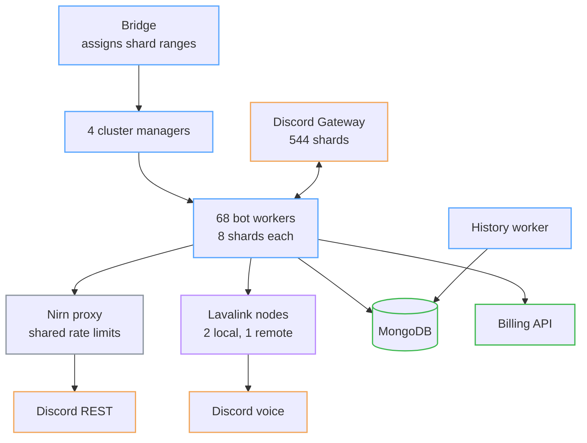
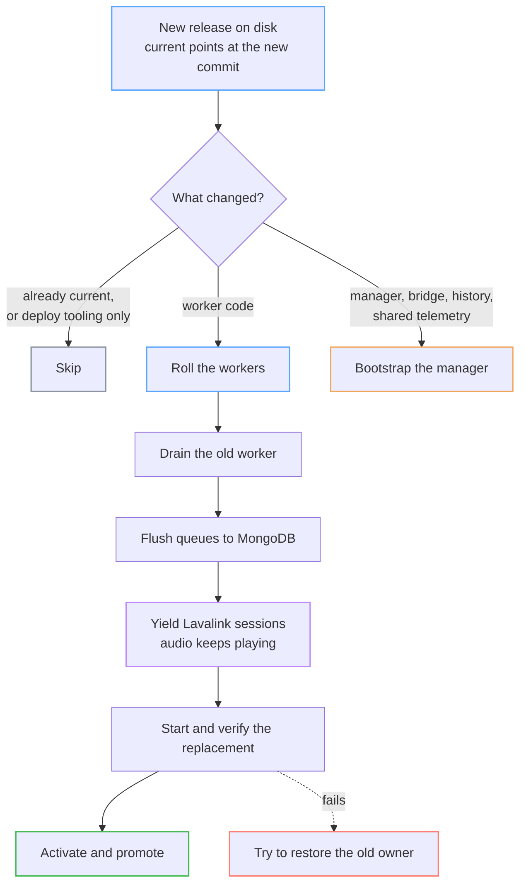
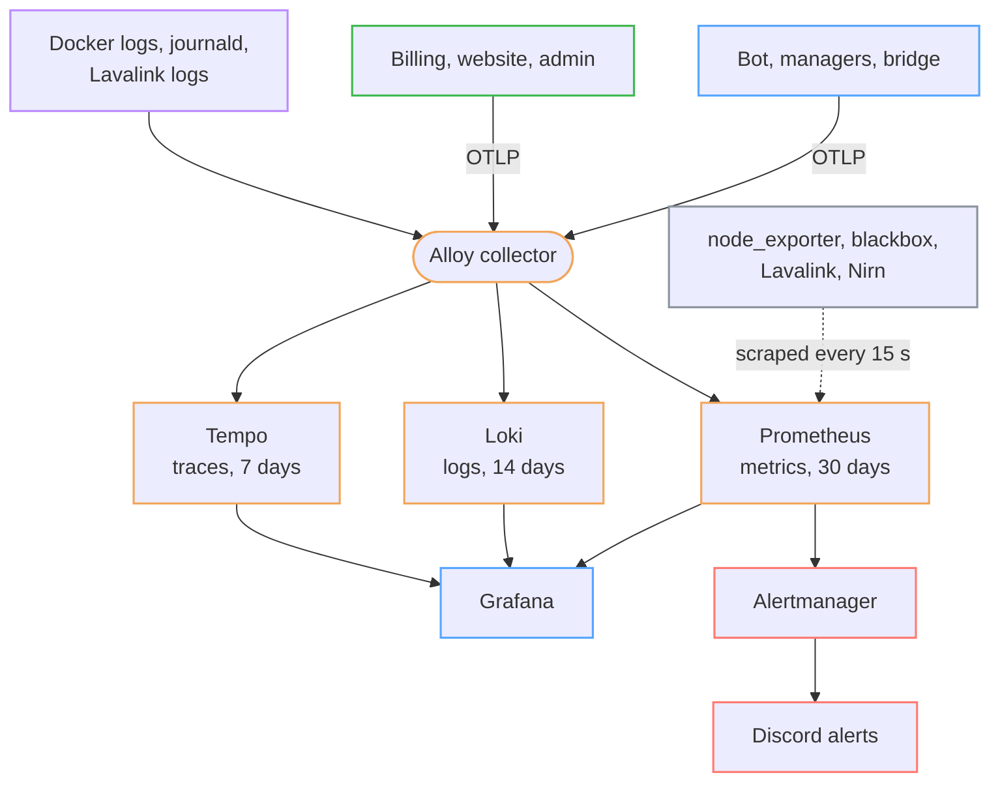
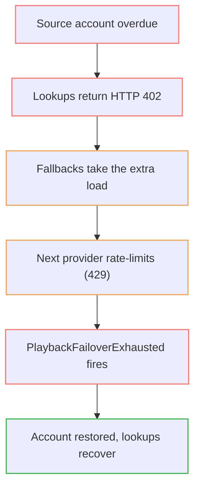

I started Uzox in September 2020 as a music bot for Discord. It's still running, and it has become the thing I learn the most from. This post is a tour of how it works and how I keep it up: the architecture, the deploys, the metrics and logs, one bad night, and an AI incident-response loop that I built and then removed.

Today (Oct 19, 2026) Prometheus says the bot is in about 544,000 servers. Around 18,600 people used it in the last day, 65,000 in the last week and 163,000 in the last month. It starts roughly 233,000 tracks and handles about 249,000 Discord interactions a day, and at any moment around 500 to 600 players are actively playing audio.

## Table of contents

## How it's built

The bot is Node.js on discord.js. Discord requires sharding at this size, and Uzox runs **544 shards**, eight per worker, so there are **68 worker processes**. Four cluster managers (using `discord-hybrid-sharding`) spawn and supervise the workers, and a bridge (`discord-cross-hosting`) hands out shard ranges. The managers and workers run on a large bare-metal server, and the rest of the infrastructure is spread across other servers. The "four machines" in the manager config are four assignment slots on that host, not four separate hosts.

It wasn't always this way. Uzox used to run on a Kubernetes cluster of 25 nodes. After I moved to bare metal I didn't need it anymore, so I dropped it, and the fleet is simpler to run and to reason about now.

A few other pieces matter more than they look:

- **Discord REST goes through Nirn**, a proxy that tracks rate limits for the whole fleet. With 68 workers, per-process rate limiting would be a mess.
- **Audio isn't played by the bot.** Workers talk to **Lavalink** nodes (two local, one remote) through Shoukaku, and Lavalink streams into Discord voice. Nodes are chosen by their load penalties, with a preference based on the server's plan.
- **MongoDB** (via Mongoose) holds guild settings, saved queues, favourites, queue backups, Lavalink session records and listening history.
- **Finding a track and playing it are separate steps.** A song can be identified through one catalog and played from a different source. Each worker keeps circuit breakers per source, so when one starts failing the bot removes it from rotation for a couple of minutes and falls back to another.
- **A history worker** aggregates listening events in the background. Raw events expire after 90 days, daily counters after 45, and long-term aggregates stay. It processes in bounded batches with checkpoints and a lease, so it can pick up where it left off after a crash.

The bot is about 24,000 lines of JavaScript with 143 test files. On Oct 16 the full suite ran 258 suites and 2,782 tests, plus strict ESLint, a dependency check and a dead-code check.

## Deploying without dropping music

The thing I'm proudest of is that I can ship a new version while people are listening.

Each release is a Git snapshot under `/srv/uzox/releases/<commit>`, with `current` and `previous` symlinks. Managers load their workers from the `current` symlink, so a new release is picked up the next time a worker is replaced. A rollback is flipping the link back.

For each manager, the deploy script chooses one of three actions. It skips the manager if it's already on that release or only deploy tooling changed. It rolls workers if only worker code changed. It bootstraps the manager itself if manager, bridge, history-worker or shared telemetry code changed.

Replacing a worker goes in order. The old worker drains and flushes its queues to MongoDB. It yields its Lavalink sessions, so the audio keeps playing on the node. The replacement starts and is verified, and only then does it take over. If something fails, the script tries to restore the old owner. A cold manager start can take up to 25 minutes to be ready, because Discord rate-limits identifying shards. The script waits for three consecutive ready checks before it moves on.

I test the hard part in isolation. A harness starts a second bot with a separate token and a throwaway database, and refuses to run if any setting could touch production. In one run on Aug 24, a Spotify track kept playing on the same Lavalink node and session through a worker replacement, and its position went on from 5.7 s to 145.7 s. A second harness puts a fake source proxy in front of the audio source and makes it return errors, rate-limit, hang, or stall a stream mid-track, so failover is tested against real failures.

## Metrics, logs and traces

Everything speaks OpenTelemetry over OTLP/HTTP to one collector, **Grafana Alloy**. Metrics go to **Prometheus**, traces to **Tempo**, and logs to **Loki**, and **Grafana** sits on top of all three. Prometheus also scrapes node_exporter, blackbox probes (the website, the metrics route, Discord's gateway discovery and the REST proxy), Lavalink and Nirn every 15 seconds. Retention is 30 days for metrics, 14 days for logs and 7 days for traces. Today it holds about 30,000 active series.

The rule that kept this stack healthy is on the first page of the README: **metric labels must be bounded**. Service, cluster, plan, result and normalized error kind are fine. User IDs, guild IDs, URLs and error messages go in logs and traces, never in labels. With half a million servers, one guild label would be the end of Prometheus.

Logs are structured JSON from Pino with `service`, `level`, `event` and `revision`, plus `trace_id` and `span_id` when there's a trace, and secrets are redacted in the logger. Alloy collects Docker logs and journald, and it tails Lavalink's Spring log files, joins Java stack traces into single events, and drops INFO request noise. From a log line in Grafana you can open its trace.

_Aggregate fleet metrics for the last 24 hours (UTC), from the same Prometheus._

The overview dashboard has more than 60 panels (guilds, players, shard lifecycle, source latency, history aggregation, active users) and there are separate dashboards for Lavalink, Nirn, and logs with traces.

There are 40 alert rules in two groups, and the bot alerts have unit tests. Fifteen cover the platform itself: Prometheus, telemetry delivery, Tempo, host disk and memory, and cardinality growth. The other 25 cover the bot: Discord gateway abnormal closes and storms, shard errors, a stale manager heartbeat, playback failures, a source going out of rotation, failover running dry, Lavalink load failures, queue persistence, billing webhook failures, and a collapse in listening. Alerts go to a Discord channel through Alertmanager. Critical alerts group after 15 seconds and repeat every 30 minutes, warnings wait 45 seconds and repeat every 12 hours, and a critical alert silences the warnings for the same service.

I also contributed to the tooling I use. The metrics for track plays and load results in Lavalink itself came from my [pull request #1188](https://github.com/lavalink-devs/Lavalink/pull/1188), which is merged upstream.

## A bad night in October

On Oct 16, around 02:10 Berlin time, alerts started firing. A source I depend on began returning HTTP 402. The account behind it had an overdue payment, which I fixed during the investigation. The fallbacks then took the extra load and the next provider started rate-limiting. In one hour there were roughly 475 successful fallback attempts and 537 failed ones, and the number of playing players dipped from about 543 to 474. A critical `PlaybackFailoverExhausted` alert fired. The lookups started succeeding again at about 02:35, and the critical alerts cleared by 02:40.

The more useful part was what I found while looking. The review turned up a list of defects, and a lot of them were in the monitoring itself:

- **Histograms were colliding.** 68 workers each kept their own histogram, and after Alloy collapsed process identity they wrote the same series with different values. Prometheus rejected about 239,000 samples in an hour, out of about 32.6 million sent, so some of the fleet latency numbers weren't complete. My delivery alert only fires above 5%, so it stayed silent.
- **Four managers looked like one.** All four heartbeats collapsed into a single series, so a surviving manager could keep it fresh while another one was down.
- **Bot traces weren't on.** Metrics have a default endpoint but traces need one configured, so the bot, managers and bridge sent no traces even though Tempo was healthy.
- **A real bug:** saving a queue crashed when the current track was null.
- **A race:** a very short track could end before `playTrack()` finished, and the end event was thrown away, so the player sat idle.

The fixes were careful. I gave each manager its own heartbeat label, applied in memory so nothing restarted. I made the saved-queue code reject empty snapshots so it can't overwrite a good saved queue with nothing. I fixed the short-track race and patched all 68 workers in place. I also saved the queues of 23 abandoned voice sessions to `/requeue` (519 entries) before removing them. The same fixes then went out as a normal release on Oct 17, because an in-memory patch is lost when a worker is replaced, and I added a default 10% trace sampling to the startup config.

The lesson I took from that night is that an alert state only tells you about the last few minutes, and a healthy scrape doesn't mean people are hearing music. I now treat "does the monitoring tell the truth?" as a separate question from "is the system up?".

## The AI incident-response loop I took out

For a while, Uzox had a closed-loop AI incident pipeline. It correlated alerts, user reports from Discord and telemetry, localized the failure, opened a fix, merged it through CI, and shipped it to every cluster. At its best it went from alert to production in about 20 minutes, with a mean time to recovery of around five minutes. I'm proud of that, and I removed it.

I took it out because I wasn't comfortable or confident enough yet with it running my app on its own. A fix that passes tests can still be the wrong fix, and "all clusters" is a big blast radius for a diagnosis made at 3am.

The October night is a good example of what makes me uneasy. The root cause was an overdue account, which no code change would have fixed, and some of the dashboards an agent would have reasoned from were wrong in the ways listed above. An automated loop would have been confidently working from bad data.

What I do now is closer to a supervised assistant. The investigation is read-only first, and nothing changes until I explicitly authorize it. Changes get applied narrowly, with snapshots of anything I might need to restore, and they're verified afterwards. I'd like to bring autonomy back one step at a time: let it propose, let it act on low-risk things with a hard limit on scope, and keep a human for anything that touches every cluster. I want to know how to build the limits before I build the loop.

## The rest of the system

- **Billing** is its own service (Express, MongoDB, Lemon Squeezy). It verifies signed webhooks, owns the premium collections, and answers authenticated entitlement requests from the bot and the website. Nothing else reads those collections directly. If billing is unreachable, the bot serves the last known entitlement so nobody loses premium during an outage. Reconciliation scripts default to dry-run.
- **The website** is Next.js with Discord OAuth. It checks guild permissions with the signed-in user's own token and gets its command list from a committed snapshot, never by importing bot code.
- **The admin dashboard** is React and Express behind Cloudflare Access. It validates the Access JWT against an allowlist, blocks cross-origin mutations, and writes every control action to an audit log in Loki. Its controls are deliberately narrow: dispatch an immutable revision, cancel a run, or rerun failed jobs. It can't run arbitrary commands.
- **Web deploys are blue/green.** Billing, website and admin each run in two alternating slots. The deployer starts the idle slot, checks health, switches Caddy's upstream atomically, confirms the public route reports the new Git revision, and switches back if that fails. Containers run unprivileged with a read-only filesystem and no extra Linux capabilities.
- **CI** for each web service builds one immutable image, tests that exact image, and ships it. Production never rebuilds from source.

## The stack, in one list

Node.js 22/24, discord.js 14, discord-hybrid-sharding, discord-cross-hosting, Shoukaku and Lavalink (Java, with plugins for sources, lyrics and YouTube), MongoDB with Mongoose, Express, Next.js, React, Pino, Jest, ESLint, Knip, Docker and Docker Compose (Kubernetes before the move to bare metal), Caddy, Cloudflare (DNS, proxy and Access), GitHub Actions with self-hosted runners, OpenTelemetry, Grafana Alloy, Prometheus, Alertmanager, Loki, Tempo, Grafana, node_exporter, blackbox_exporter, Nirn, and Lemon Squeezy.

## What I haven't done yet

I'd rather say it than have you find it. MongoDB is a single node, and I haven't run a restore drill from off-host backups. The managers and Lavalink nodes live in tmux sessions, so rebuilding the machine after a reboot is still a manual procedure I want to document and test. The histogram fix is deployed, and failed remote-write samples dropped from about 239,000 an hour to about 14,000, but that isn't zero yet. I also haven't confirmed that bot traces are flowing end to end now that tracing is on by default.

If you're building something that has to stay up, the most useful thing I can pass on is that the boring work counts: bounded labels, tests for your alerts, and a deploy you can roll back.
